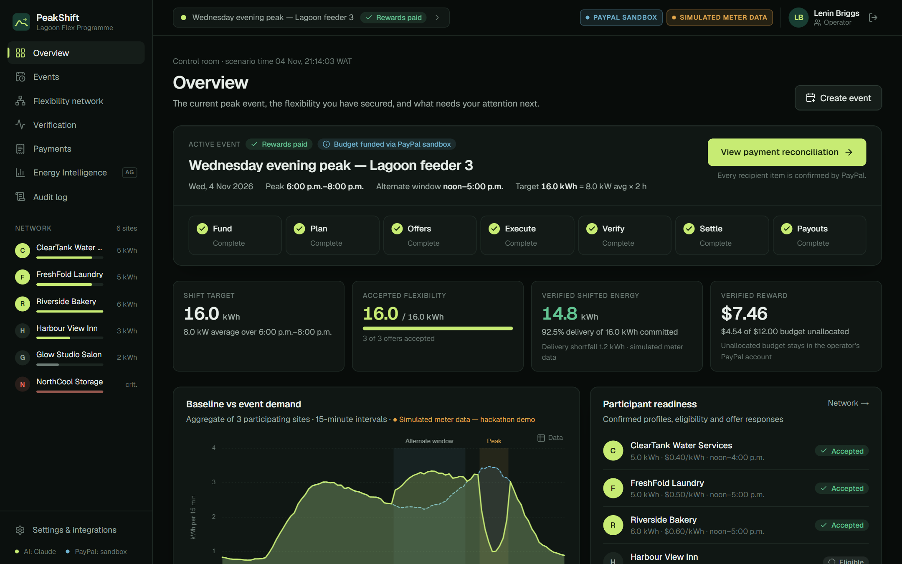
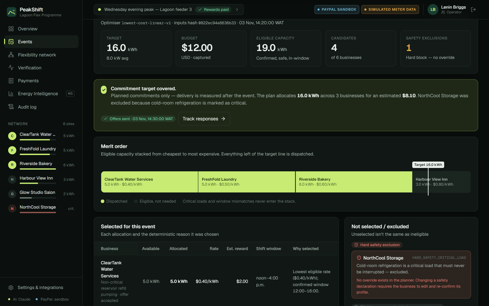
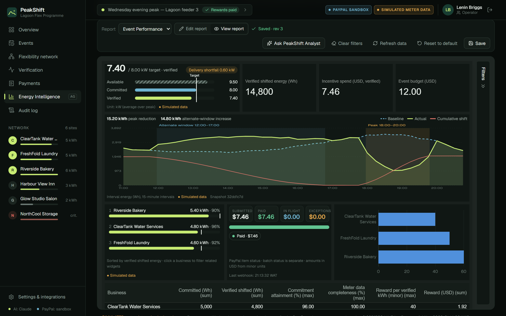
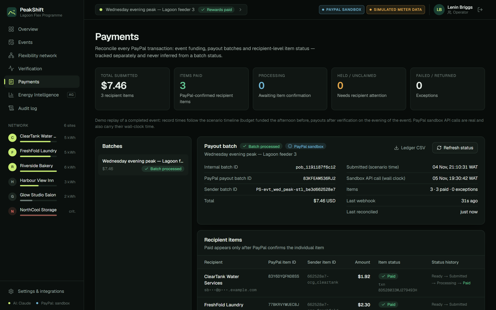

# PeakShift — make flexibility valuable

**AI-coordinated demand flexibility with verified PayPal incentive payouts.**

PeakShift helps an energy programme operator turn small-business electricity flexibility into a resource it can **coordinate, verify and pay**. Businesses describe what they can move in plain language; AI structures it and the owner confirms it. A deterministic optimiser picks the lowest-cost safe plan, businesses accept voluntarily, and meter data verifies what actually shifted. The operator approves the settlement, and **PayPal Payouts** sends each reward — reconciled per recipient.

> **AI interprets. Deterministic code allocates and verifies. Humans approve. PayPal moves the money (sandbox).**

**[▶ Open the live demo](https://peakshift-seven.vercel.app/demo)** · **[Watch the 3-minute video](YOUTUBE_VIDEO_URL)** · [Judge walkthrough](#judge-walkthrough-5-minutes)

## Product screenshots

| Operator overview | Dispatch planning |
|---|---|
| [](docs/screenshots/01-operator-overview.png) | [](docs/screenshots/02-dispatch-planning.png) |
| **Energy Intelligence (AG Studio)** | **Payment reconciliation** |
| [](docs/screenshots/03-energy-intelligence.png) | [](docs/screenshots/04-payment-reconciliation.png) |

## Live demo and video

**Live demo:** https://peakshift-seven.vercel.app

No PeakShift account or installation required. Explore the application immediately using demo accounts. Completing the PayPal Checkout flow requires a PayPal sandbox Personal buyer account, provided in the Devpost testing instructions.

1. Open **https://peakshift-seven.vercel.app/demo** and click **Open operator workspace**. Every PeakShift account is a one-click role switch (demo-only and audited).
2. **Check the event state first.** The demo is shared between reviewers. If the Wednesday peak event is already complete, click **Start a fresh run** on the Overview to restore it to *Awaiting funding*. Prefer just to look around? Leave it: a completed run shows every screen fully populated.
3. **Fund the $12.00 budget** with real PayPal sandbox Checkout, signing in with the sandbox Personal buyer account from the Devpost testing instructions (or any sandbox Personal account of your own). The app's own seller account cannot pay itself.
4. Follow the [judge walkthrough](#judge-walkthrough-5-minutes). Every other step — plan, offers, verification, settlement, real sandbox Payouts and signed webhooks — runs in the app with no further credentials.

**Video:** [Watch the 3-minute product demonstration](YOUTUBE_VIDEO_URL). The video shows the full experience; the walkthrough below is the detailed, hands-on guide for inspecting the implementation.

## The problem and how PeakShift works

Evening peaks push local feeders past their rating, and the usual answers are load-shedding or diesel. Bakeries, laundries, water pumps and salons all run energy-heavy tasks that could happen a few hours earlier — but flexibility programmes rarely include them, because small sites are costly to enrol, hard to verify and expensive to pay in small amounts.

| Step | What happens | Who decides |
|---|---|---|
| **Fund** | The operator creates a peak event and funds the reward budget with **PayPal Checkout** (Orders v2). The server verifies the capture. | Operator + PayPal |
| **Profile** | Owners describe flexible tasks in plain words; **Claude** turns them into a structured draft that the owner confirms. | AI proposes, owner confirms |
| **Plan** | A deterministic optimiser builds the lowest-cost safe plan, with a reason code for every business. Critical loads are blocked by a safety rule, not by price. | Deterministic code |
| **Offers** | Each business accepts or declines on its phone. | Business |
| **Verify** | 15-minute meter data is compared with a baseline; only verified energy earns a reward. | Deterministic code |
| **Settle & pay** | The operator approves server-calculated amounts; **PayPal Payouts** pays each recipient, reconciled per item through signed webhooks. | Operator + PayPal |
| **Analyse** | **AG Studio** Energy Intelligence and the **PeakShift Analyst** explain what happened — with no ability to move money. | AI (read-only) |

## Demo scenario and key results

| | |
|---|---|
| Event | **Wednesday evening peak — Lagoon feeder 3**, Wed **4 Nov 2026** (a completed event, replayed), peak **6–8 p.m.**, alternate window **noon–5 p.m.** (Africa/Lagos) |
| Target | **8.0 kW** average over 2 h = **16.0 kWh** to shift |
| Budget | **$12.00** USD (sandbox) |
| Plan | ClearTank 5 kWh @ $0.40 + FreshFold 5 kWh @ $0.50 + Riverside 6 kWh @ $0.60 = **$8.10** — commitment target covered |
| Excluded | **NorthCool Storage**: refrigeration is a critical load (hard safety rule) · Glow Studio: window mismatch · Harbour View: eligible but not needed |
| Plan vs delivery | **16.0 kWh committed** · peak reduction 15.2 kWh · alternate-window increase 14.8 kWh · **14.8 kWh verified = 92.5% delivery, 1.2 kWh shortfall** (not paid) |
| Per business | ClearTank 4.8 / 5.0 kWh (96%) · FreshFold 4.6 / 5.0 kWh (92%) · Riverside 5.4 / 6.0 kWh (90%) |
| Money | **$12.00 budget funded** (captured into the operator's PayPal account — not escrow) · **$7.46 rewards paid** ($1.92 + $2.30 + $3.24, each PayPal-confirmed) · **$4.54 unallocated budget remaining** |

**Verified shifted energy = min(peak reduction, alternate-window increase), capped at the accepted commitment.** These figures are unit-tested (`npm test`).

**Scenario timeline.** The demo replays the completed 4 Nov event on a scenario clock (`lib/clock.ts`), so every record is in order: budget funded, plan built and offers accepted on the afternoon of Tue 3 Nov; the peak runs 18:00–20:00 on Wed 4 Nov; meter import, verification, settlement approval and PayPal payouts follow that evening. Real PayPal sandbox calls still happen when you click — their wall-clock times are kept alongside and shown on the Payments screen.

## What is real vs simulated

| Real | Simulated or fictional (labelled on screen) |
|---|---|
| PayPal sandbox **Orders v2** capture, **Payouts** batches and **webhooks** (signature-verified) | All six businesses and their owners are fictional |
| **Claude** calls for profile extraction, event briefs and the Analyst | 15-minute meter readings are deterministic synthetic data |
| Server-side optimiser, verification and reward maths (integer Wh and cents) | The event is a replay on a scenario clock (real API times are kept alongside) |
| AG Studio, AG Grid and AG Charts rendering live event data | Without sandbox keys, a clearly labelled **PayPal simulator** runs instead |

Nothing here claims a real grid outcome. Every energy screen carries a *Simulated meter data* label.

## Judge walkthrough (≈5 minutes)

1. Open `/demo` → **Open operator workspace** (Lenin Briggs, operator).
2. **Overview** shows the active event, its 7-stage pipeline, KPIs, the baseline demand chart and the critical-load notice.
3. **Fund event budget** → PayPal Checkout (sign in with the sandbox Personal buyer account) → the server verifies the capture.
4. **Find the lowest-cost plan**: the merit-order stack, the allocation table with reasons, and the *Not selected / excluded* panel (hard safety vs. not needed vs. window mismatch). **Publish 3 offers**.
5. **Offers → Open as business** (demo role switch). On a phone-sized view, review the offer, tick the commitment statement and **Accept**. Repeat for the other two.
6. **Execute → Run demo event** replays deterministic 15-minute data, then **Run verification**.
7. **Verify**: baseline vs event chart, the plain-language formula, per-business attainment vs meter-data completeness, and a drilldown to individual interval readings.
8. **Energy Intelligence** (`/operator/intelligence`): the *Event Performance* report opens in View mode. Click a business in **Participant Contribution** and Load Shift Evidence and Settlement Pulse re-scope through the data-model relationships; **Clear filters** restores the view. Click **Ask PeakShift Analyst**, then ask *"Build a chart comparing committed versus verified shifted energy by business for this event"* and *"Why was NorthCool Storage excluded from this dispatch?"*. Try *"Send the payouts now"* to see the refusal.
9. **Review rewards and settlement** → **Approve and send payouts** → **Confirm payout submission**.
10. **Payments**: batch vs item status tracked separately, item history, signature-verified webhook receipts (rejected ones grouped separately), the redacted PayPal response and a ledger CSV.
11. Switch to the business view → **Earnings** shows the verified reward and PayPal reference — and only that business's data.

**Fresh run:** Overview → **Start a fresh run** (operator, audited). It resets a completed or unfunded event immediately, but refuses while another reviewer’s run is in progress until it has been idle for 10 minutes. The platform admin can still reset unconditionally from Settings.

### Demo accounts (role switch on `/demo`, demo-only and audited)

| Account | Role |
|---|---|
| Lenin Briggs | Operator — Lagoon Flex Programme |
| Demo Admin | Platform admin — demo reset, integration health |
| Nina Nguyen | Owner, ClearTank Water Services (payout recipient) |
| Piers Wagner | Owner, FreshFold Laundry (payout recipient) |
| Celine Schaumer | Owner, Riverside Bakery (payout recipient) |
| Kemi Lawal · Adaeze Nwosu · Ibrahim Musa | Owners of Harbour View Inn, Glow Studio Salon and NorthCool Storage (not paid in the default scenario) |

## How AI is used (and its guardrails)

| Capability | What it does | Guardrails |
|---|---|---|
| **Flexibility Profile Extractor** | Business free text → structured draft (activities, windows, capacity, rate, constraints, source evidence, questions) | Strict JSON-schema structured output + Zod validation; capacity and rate are **kept only if grounded in the owner's words**; refrigeration, medical, security and fire loads are **forced critical**; drafts are never dispatchable until the owner confirms each safety declaration |
| **Event Brief Parser** | Operator brief → proposed event fields, with the kW↔kWh derivation shown | Every value is labelled *AI-proposed* until confirmed |
| **PeakShift Analyst** (AG Studio Agent Framework) | Answers questions from the event's data and adds widgets to the Studio canvas | Only read/compose tools. **No tool exists** to pay, approve, change rates or budgets, or edit safety or meter data; the server proxy also strips anything money-related |

The optimiser, verification and reward calculation are deterministic TypeScript, never LLM output. The model is Claude (`ANTHROPIC_MODEL`, default `claude-opus-5-5`), called **server-side only**. With no `ANTHROPIC_API_KEY`, a deterministic offline extractor and analyst run with the same schemas and safety rules, and the UI says so.

## PayPal integration

- **Checkout (Orders v2)** funds the event budget. The capture is verified server-side (status, amount, currency, reference) before the event shows **Budget funded**. The money goes to the operator's own PayPal account — it is **not escrow**, and the UI says so.
- **Payouts API** sends one batch per approved settlement. The `sender_batch_id` and `sender_item_id`s are **persisted before the API call**, so a retry reuses the same IDs and an ambiguous timeout goes to *Awaiting confirmation* — never a second batch.
- **Webhooks** (`/api/v1/webhooks/paypal`): signature verified via `verify-webhook-signature`, de-duplicated by event ID, then the **authoritative batch and item detail is re-fetched**. Unverified or unsupported events never change state; they are kept, with their reason, in a separate *Rejected / unsupported* list and the audit log.
- **Item-level reconciliation**: a batch `SUCCESS` never marks anyone paid. The event shows **Rewards paid** only when every recipient item is PayPal-confirmed (Paid, Unclaimed, Held, Failed and Returned are tracked separately).

## Energy Intelligence and AG Studio

`/operator/intelligence` embeds **AG Studio 3.1.0** (`ag-studio-react`) as a read-only analytics layer, alongside **AG Grid** and **AG Charts** across the app. Operations and money movement stay in their controlled screens.

**Data contract** (`lib/analytics-contract.ts`, `GET /api/v1/analytics/events/:id/studio-data`)
- Nine event-scoped, camelCase tables, each with a stable `primaryKeyField`: `events`, `businesses`, `eligibility`, `offers`, `meterIntervals`, `verificationResults`, `settlementItems`, `payoutItems` and the derived `participantEfficiency` projection.
- `participantEfficiency` (`lib/efficiency.ts`) is read-only: one row per business whose PayPal payout **item** is confirmed `SUCCEEDED` and whose verified energy is positive, with `costPerVerifiedKwhUsd` (paid USD ÷ verified kWh) and `eventWeightedAverageCostPerVerifiedKwhUsd` (total paid ÷ total verified kWh — never a mean of rates) precomputed, so charts need no calculated measures. Demo result: $0.40 / $0.50 / $0.60 per kWh, weighted average $0.5041.
- Fourteen explicit many-to-one relationships, so a single widget can query across tables and cross-filtering stays linked.
- Energy is integer **Wh**, power is **kW**, money is integer **minor units** plus `currencyCode`, timestamps are UTC ISO.
- Every response carries `snapshotId`, `dataAsOfUtc`, `dataMode: SIMULATED` and `schemaVersion`. No emails, PayPal recipient identifiers, secrets or free-text profiles are included.

**Five PeakShift custom widgets** (`components/intelligence/widgets.tsx`, registered with `createWidgets` under a *PeakShift* menu)

| Widget ID | Answers |
|---|---|
| `peakshift-flex-capacity` | Available, committed and verified kW against the target, with a target marker and a delivery-shortfall status |
| `peakshift-load-shift-evidence` | Baseline vs actual interval energy, shaded peak and alternate windows, peak reduction, alternate-window increase, cumulative shift, and a Wh/kW toggle |
| `peakshift-participant-contribution` | Ranked verified energy with a commitment marker and attainment %. Click to cross-filter; unverified businesses are grouped separately |
| `peakshift-settlement-pulse` | Submitted, paid, in-flight and exception amounts by PayPal **item** status, plus the last webhook time |
| `peakshift-unit-cost` | USD paid per verified kWh by business: horizontal bars sorted lowest first, two-decimal labels, payout/energy/unit-cost tooltip and a dashed reference line at the event's weighted average |

Each widget has typed data mappings (roles, cardinality, `aiDescription`), a configuration form, `defaultSize`/`minSize` and `ai` metadata, and handles loading, incomplete-mapping, no-data and simulated states. Data comes from the widget data handle, so cross-filter and data changes arrive live.

**Reports** (`lib/reports.ts`, `/api/v1/analytics/reports…`)
- The versioned *Event Performance* template (`lib/report-template.ts`) is created per organisation and event on first open. It opens in **View mode** on a non-overlapping 24-track layout with the AI Assistant collapsed.
- Saves are debounced (900 ms) via `onStateUpdated` and use **optimistic concurrency** on `revision`: a stale write returns 409 and the UI offers *Reload latest*. Invalid states are rejected with 422; a 512 KB size cap applies.
- Restore is validated against the widget registry; *Reset to default* is audited.

**PeakShift Analyst** (Agent Framework): `createAiHarness` with a primary `peakshift-analyst` agent that **delegates to AG Studio's built-in `page`, `widget` and `data` agents** (`tools.delegateTo`), all on one PeakShift server adapter.
- **Read-only domain tools** (`POST /api/v1/analytics/agent-tools/*`): `peakshift_event_context`, `peakshift_explain_exclusion` (reason code, rule ID, source record), `peakshift_verification_breakdown`, `peakshift_settlement_summary` and `peakshift_analytics_freshness`. Tenancy comes from the session, never from the model.
- **Studio tools**: view schema/report/page/widget, `execute_query`, `add_widget`, `position_widget` and page filters.
- **Server adapter** `POST /api/v1/ai/studio`: authenticated, same-origin, rate-limited (30/min per user, 60/min per IP), with a model allowlist (`ANTHROPIC_MODELS`), size/token/wall-clock limits, abort propagation and a tool allowlist that strips anything money-related. Usage is logged to the audit trail.

**Known gap**: AG Studio 3.1.0 doesn't publicly export the shape builder that a custom widget's `formatShape` needs, so the custom widgets ship `ai.description` and per-mapping `aiDescription` but no `formatShape` — the agent can add and map them but not restyle them.

## Local installation and setup

Requires **Node 20+** (tested on Node 24).

```bash
npm install
cp .env.example .env.local   # optional: add PayPal sandbox + Anthropic keys
npm run dev                  # http://localhost:3000 → /demo
npm test                     # 36 tests: domain, Energy Intelligence, chronology, reconciliation, unit cost, fresh-run guard
npm run lint                 # ESLint (next/core-web-vitals + typescript)
```

With no keys at all, the app runs end to end using the labelled PayPal simulator and the offline AI rules. State lives in `./.data/state.json` (atomic writes); delete it, or use the admin reset, to restore the seed.

**PayPal sandbox setup**
1. In the PayPal Developer Dashboard, create a sandbox REST app and enable **Payouts**. Put its credentials in `PAYPAL_CLIENT_ID` / `PAYPAL_CLIENT_SECRET`.
2. Create a sandbox **Personal** account for **every business that will receive a payout**. The default scenario pays only three: **ClearTank Water Services**, **FreshFold Laundry** and **Riverside Bakery**. Add their emails to `PAYPAL_SANDBOX_RECIPIENTS` (format below). Businesses without a configured account fall back to placeholder addresses, which PayPal returns as **Unclaimed** (shown as *Needs attention*).
3. Create one more sandbox **Personal** account to act as the buyer who approves the $12 Checkout.

## Environment variables

| Variable | Purpose |
|---|---|
| `DATABASE_URL` | Postgres connection string for persistent application state. Empty = local file store |
| `SESSION_SECRET` | HMAC secret for the demo session cookie |
| `PAYPAL_CLIENT_ID`, `PAYPAL_CLIENT_SECRET` | Sandbox REST app (with **Payouts** enabled). Empty = labelled PayPal simulator |
| `PAYPAL_WEBHOOK_ID` | Webhook ID for signature verification (subscribe to `PAYMENT.PAYOUTSBATCH.*` and `PAYMENT.PAYOUTS-ITEM.*`) |
| `PAYPAL_SANDBOX_RECIPIENTS` | Maps PeakShift business IDs to PayPal Personal sandbox recipient emails (format below) |
| `ANTHROPIC_API_KEY`, `ANTHROPIC_MODEL` | Claude for extraction and the Analyst (default model `claude-opus-5-5`). Empty = offline rules |
| `ANTHROPIC_MODELS` | Optional comma-separated model allowlist for the Analyst endpoint |
| `AG_STUDIO_LICENSE_KEY` | AG Studio licence key (removes the trial watermark). `AG_STUDIO` or `NEXT_PUBLIC_AG_STUDIO_LICENSE_KEY` also work |
| `CRON_SECRET` | Optional. If set, the daily database keep-alive cron must present it |
| `PEAKSHIFT_STORE=file`, `PEAKSHIFT_PAYPAL=simulator` | Local testing only: force the file store / labelled simulator even when `DATABASE_URL` or sandbox keys are set |

**`PAYPAL_SANDBOX_RECIPIENTS` format** — either explicit pairs:

```
PAYPAL_SANDBOX_RECIPIENTS=org_cleartank=nina@example.com,org_freshfold=piers@example.com,org_riverside=celine@example.com
```

or a plain list, assigned in dispatch order **ClearTank, FreshFold, Riverside, Harbour View, Glow Studio**:

```
PAYPAL_SANDBOX_RECIPIENTS=nina@example.com,piers@example.com,celine@example.com
```

Business IDs: `org_cleartank`, `org_freshfold`, `org_riverside`, `org_harbour`, `org_glow` (`org_northcool` is never paid — it is a critical load). Recipient emails stay server-side and are masked in the UI and analytics.

## Deployment instructions (Vercel + Postgres)

1. **Database.** Create a Postgres database (Supabase works well). In Supabase, open **Connect → Transaction pooler** and copy the URI (port `6543`). Optionally apply `supabase/migrations/20261105000000_peakshift_store.sql`; the app also creates its two tables on first connection.
2. **Environment variables** (Vercel → Project → Settings → Environment Variables): `DATABASE_URL`, `SESSION_SECRET`, `PAYPAL_CLIENT_ID`, `PAYPAL_CLIENT_SECRET`, `PAYPAL_SANDBOX_RECIPIENTS`, `ANTHROPIC_API_KEY` and `AG_STUDIO_LICENSE_KEY` (see the table above).
3. **Deploy:** `npx vercel --prod` from the project folder, or import the GitHub repo in Vercel. `vercel.json` pins functions to the London region and schedules a daily keep-alive (`/api/v1/cron/keepalive`) so a free-tier database never pauses for inactivity.
4. **Webhook.** In the PayPal Developer Dashboard, add `https://<your-app>.vercel.app/api/v1/webhooks/paypal`, subscribe to the `PAYMENT.PAYOUTSBATCH.*` and `PAYMENT.PAYOUTS-ITEM.*` events, copy the Webhook ID into `PAYPAL_WEBHOOK_ID` and redeploy.

With `DATABASE_URL` set, state lives in Postgres (`peakshift_state`). Every request loads the latest document and every write is a row-locked transaction, so concurrent serverless instances never overwrite each other.

## Technical architecture

```
app/
  demo/                  judge entry + role switch
  operator/*             control room (overview, events/[id] stages, network, payments, intelligence, audit, settings)
  business/*             mobile-first participant portal (home, flexibility, offers, earnings, profile)
  api/v1/[...path]       REST API with server-side role and ownership checks
lib/
  optimiser.ts           eligibility gates + lowest-cost allocation + reason codes
  verification.ts        M&V: verified = min(peak reduction, alternate-window increase), capped at commitment
  meter.ts               deterministic synthetic 15-min readings
  clock.ts               scenario clock — keeps every record on the event's own timeline
  services.ts            every state transition, audited
  paypal.ts              OAuth, Orders, Payouts, webhook verification, redaction
  store.ts               Postgres (row-locked) / file store behind one contract
  ai/                    Claude client, profile extractor, brief parser, analyst, AG Studio proxy
  analytics-contract.ts  event-scoped AG Studio data sources + relationships
  efficiency.ts          participantEfficiency projection (paid USD per verified kWh, weighted average)
  status.ts, terms.ts    one shared status and metric vocabulary used by every screen
components/              design system, charts (AG Charts), grids (AG Grid), AG Studio workspace
tests/                   domain, Energy Intelligence, chronology, reconciliation, unit cost, fresh-run guard (36 tests)
```

Money is integer cents and energy is integer Wh throughout. Rewards are recalculated on the server at approval and checked against a review hash, so browser totals are never trusted.

## Known limitations

- Single peak window and a linear lowest-cost model, not a network-constrained dispatch.
- The M&V method is a conservative demo heuristic, not a certified methodology.
- Demo auth is a signed cookie with a role switch, and the live demo is shared between reviewers (Start a fresh run is one click on the Overview, guarded so it never wipes another reviewer’s active run).
- State is a single JSONB document in Postgres rather than a normalised schema — enough for one demo organisation; the read/mutate contract allows a later move to relational tables.

## Licence and acknowledgements

PeakShift is released under the **MIT License** (see `LICENSE`).

- **AG Studio and AG Grid Enterprise** are commercial products by AG Grid Ltd, used under AG Grid Ltd's licence terms and not covered by the MIT License (see `NOTICE`). AG Charts and AG Grid Community are used under their open-source licences.
- **PayPal** REST APIs are used in the PayPal sandbox under the PayPal developer terms.
- **Claude** is accessed through the Anthropic API.
- The PayPal / AG Studio hackathon boilerplate was used as a **reference only**; its repository shows no licence file, so none of its code is copied.
- All businesses, people and meter data in the demo are fictional.
